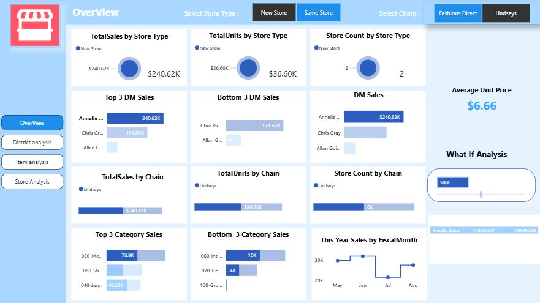
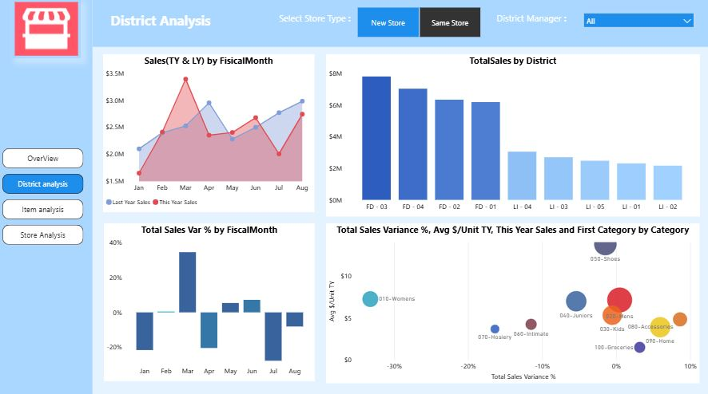
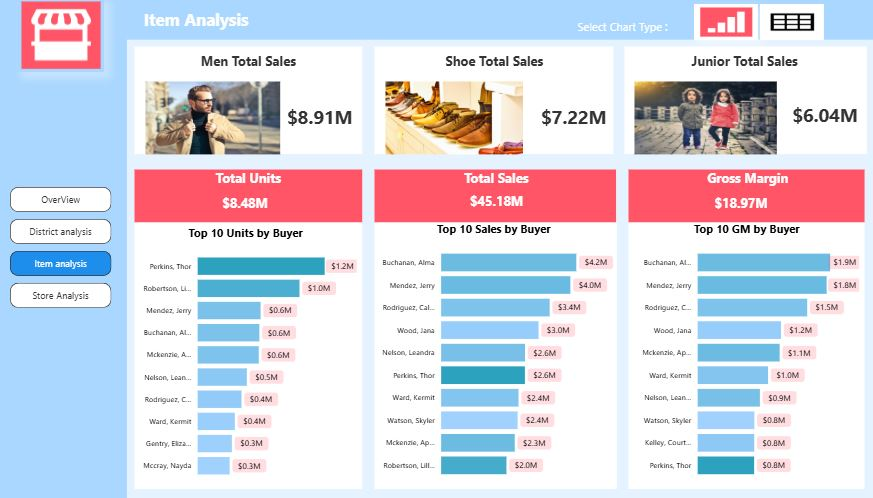
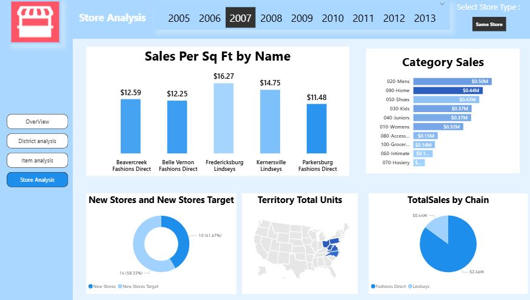

# 🛍️ Retail Analysis – Power BI Dashboard

An interactive **Power BI** dashboard analyzing the sales performance of a group of fashion and apparel stores (the **Fashions Direct** and **Lindseys** chains). It tracks sales, units sold, gross margin, and the performance of stores, districts, and buyers.

---

## 📌 Project Goals

- Track **sales and volumes** by store type (new stores vs. same stores), chain, district, and category.
- Compare **this year (TY) vs. last year (LY) sales** month by month.
- Identify the **top and bottom District Managers (DM)**, categories, and buyers.
- Measure **store productivity** (sales per square foot) and progress toward the new-store opening target.
- Simulate scenarios with a **What-If analysis**.

---

## 🗂️ Report Structure

The report has **4 pages**, accessible from the navigation menu on the left.

| Page | What it shows |
|---|---|
| **Overview** | Filters by store type and chain, Total Sales / Units / Store Count, Top & Bottom 3 DMs and categories, Average Unit Price, monthly sales trend, What-If slider |
| **District Analysis** | TY vs. LY sales by fiscal month, sales by district (FD-01 to FD-04, LI-01 to LI-05), variance %, bubble chart by category |
| **Item Analysis** | Men / Shoes / Juniors sales, Total Units, Total Sales, Gross Margin, Top 10 buyers, chart/table toggle |
| **Store Analysis** | Year selector (2005–2013), sales per sq ft by store, category sales, new stores vs. target, territory map, sales by chain |

---

## 📊 Screenshots

### Overview


### District Analysis


### Item Analysis


### Store Analysis


---

## 🔑 Key Metrics

| Metric | Value |
|---|---|
| Total Sales | $45.18M |
| Total Units | 8.48M |
| Gross Margin | $18.97M |
| Men / Shoes / Juniors Sales | $8.91M / $7.22M / $6.04M |

---

## 🛠️ Tools & Technologies

- **Microsoft Power BI Desktop**
- **DAX** for measures (TY/LY sales, variance %, average unit price, sales per sq ft, etc.)
- **Power Query** for data import and transformation
- **Star schema modeling** (fact and dimension tables: store, district, item/category, buyer, time)
- Power BI features: slicers, bookmarks, What-If parameters, tooltips, page navigation

---

## 📁 Repository Structure

```
├── LICENSE
├── README.md
├── Retail Analysis.pbix     # Power BI report
├── View1.JPG                # Overview page
├── View2.JPG                # District Analysis page
├── View3.JPG                # Item Analysis page
└── View4.JPG                # Store Analysis page
```

---

## 🚀 Getting Started

1. Download or clone the repository:
   ```bash
   git clone https://github.com/YOUR-USERNAME/YOUR-REPOSITORY.git
   ```
2. Open **Retail Analysis.pbix** with **Power BI Desktop** (Windows).
3. If needed, update the data source: *Home → Transform data → Data source settings*.
4. Navigate between pages using the left-hand menu and use the filters to explore the data.

---

## 💡 Key Insights

- **Fashions Direct (FD)** districts generate significantly more sales than **Lindseys (LI)** districts.
- Sales fluctuate strongly across fiscal months, with a notable peak in March compared to last year.
- **Men**, **Shoes**, and **Juniors** are the top-contributing categories.
- A handful of buyers account for a large share of sales and gross margin.

---


---

## 📄 License

This project is licensed under the terms of the [LICENSE](LICENSE) file included in this repository.
